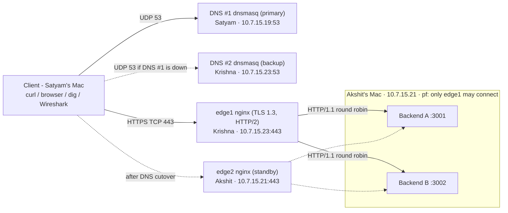

# Private Network Service

A private, secure, load-balanced and **resilient** network platform built across **3 Macs** for the Computer Networks course project.

> *The application stays simple — the network is the project.*
>
> 🎥 **Phase 1 demo video:** [Google Drive](https://drive.google.com/file/d/1XXsFh4M2UwdjVBopO7DuX3vYdPd1IA-r/view?usp=sharing)

**Phase 1 — Build & Observe:** private DNS (`dnsmasq`) → trusted HTTPS (TLS 1.3, HTTP/2) at an `nginx` edge → round-robin load balancing across two Flask REST backends → HTTP caching (`Cache-Control`, `ETag`, `304`) → Wireshark evidence of DNS, TCP and TLS.

**Phase 2 — Harden & Recover:** backup DNS resolver (Ext A) · 30 s TTL and live record changes (Ext B) · pf firewall so only the edge reaches the backends (Ext C) · health-checked failover with request retry (Ext D) · standby edge + DNS cutover (Ext E) · layer-by-layer troubleshooting tool (Ext F). Everything is generated from one inventory file and deployed over SSH by bash scripts.

---

## Project members

| Name | Enrollment | Mac | Phase 1 | Phase 2 |
| --- | --- | --- | --- | --- |
| **Satyam Kumar** (lead) | 2401010428 | Mac 1 | Private DNS (`dnsmasq`), test client, Wireshark | Primary DNS, TTL/record changes (Ext A, B), operator scripts |
| **Krishna Verma** | 2401010240 | Mac 2 | nginx edge: TLS / HTTP/2 / load balancer, mkcert CA | Backup DNS (Ext A), health checks + failover (Ext D), edge cutover (Ext E) |
| **Akshit Vats** | 2401020085 | Mac 3 | Backends A (:3001) and B (:3002), Flask | Standby edge (Ext E), backend firewall with pf (Ext C) |

## Architecture (Phase 2)



## Network inventory (24 Nov 2026 · LAN 10.7.0.0/19 · gateway 10.7.0.1)

| Node | Member | Address | Services |
| --- | --- | --- | --- |
| **Mac 1** | Satyam Kumar | `10.7.15.19` | dnsmasq :53 (primary) · test client · operator |
| **Mac 2** | Krishna Verma | `10.7.15.23` | nginx edge1 :80 → 301, :443 · dnsmasq :53 (backup) |
| **Mac 3** | Akshit Vats | `10.7.15.21` | Flask A :3001, B :3002 · nginx edge2 :443 (standby) · pf |

`app.teamX.test`, `api.teamX.test` → `10.7.15.23`, TTL 30 s. College Wi-Fi uses DHCP, so IPs change: the single
source of truth is [`team/team.env`](team/team.env) — run `scripts/update-ips.sh mac2=<ip> mac3=<ip> --deploy`.
Phase 1 addresses (Oct 2026) were `10.7.10.50` / `10.7.15.125` / `10.7.12.174`.

---

## Quick start (on Satyam's Mac)

```bash
scripts/get-my-ip.sh                                   # each Mac: current IP (send it to Satyam)
scripts/update-ips.sh mac2=10.7.15.23 mac3=10.7.15.21  # only if IPs changed (add --deploy to deploy too)
scripts/deploy.sh                                      # render + push configs to all Macs, start everything
scripts/smoke-test.sh                                  # DNS -> HTTPS -> load balancing -> caching
scripts/demo.sh check                                  # health check, layer by layer
```

One-time per client Mac (needs that Mac's password): `sudo scripts/phase2/client-setup.sh`.
All one-time admin steps are listed in the [runbook](docs/phase2-runbook.md#2-one-time-admin-steps-need-passwords--already-done-on-24-nov-2026).

## Live demo (`scripts/demo.sh`)

| Command | Shows |
| --- | --- |
| `scripts/demo.sh who` | names, IPs, roles + live status of every Mac |
| `scripts/demo.sh p1` | Phase 1 recap = final-demo steps 2–8 |
| `scripts/demo.sh A` | backup DNS: stop DNS #1, clients keep resolving via DNS #2 |
| `scripts/demo.sh B` | TTL: record change, client keeps the cached answer ~30 s, manual flush |
| `scripts/demo.sh C` | pf firewall: client → backend times out, edge → backend 200, rollback |
| `scripts/demo.sh D` | stop Backend A: every request still 200 (served by B), A rejoins |
| `scripts/demo.sh E` | DNS cutover to the standby edge, cached vs fresh clients |
| `scripts/demo.sh F` | `diagnose.sh`: names the first failing layer |
| `scripts/demo.sh break` / `answer` / `fix` | practice with a random hidden fault, reveal it, repair everything |

## Tests and evidence

```bash
scripts/phase2/run-tests.sh all        # Phase 1 regression + failures + Ext A, B, D, E  -> evidence/phase_2/logs/
scripts/phase2/run-tests.sh extC       # Ext C (asks Akshit's password for pf)
scripts/phase2/fault-drills.sh         # Ext F: 8 injected faults, each diagnosed
scripts/phase2/capture.sh flow         # Wireshark capture DNS -> TCP -> TLS -> HTTP (+ failover, cutover, isolation)
```

Phase 2 evidence index: [evidence/phase_2/](evidence/phase_2/README.md) · Phase 1 evidence: [evidence/phase_1/](evidence/phase_1/README.md)

## Repository layout

```text
team/team.env                    inventory: every IP / user / role (single source of truth)
backend/app.py                   Flask REST backend (/, /api/status, /api/cache) - same file runs as A and B
dnsmasq/dnsmasq.conf.template    Phase 2 DNS config (rendered for Mac 1 and Mac 2)   | phase1-dnsmasq.conf
nginx/nginx.conf.template        Phase 2 edge site (rendered for edge1 and edge2)     | phase1-cn-project.conf
nginx/nginx-main.conf.template   self-contained nginx main config (~/cn-project)
firewall/pf-backend-isolation.conf.template   Ext C pf rules
config/rendered/                 every config exactly as deployed
tls/                             team CA certificate (mkcert-rootCA.pem) + edge certificate (no private keys)
scripts/
  get-my-ip.sh  update-ips.sh  render-configs.sh  deploy.sh  smoke-test.sh  diagnose.sh  demo.sh
  run-backend.sh  phase1-evidence.sh                 (Phase 1)
  lib/common.sh                  SSH / inventory helpers
  phase2/cn.sh                   per-Mac service control (dns, dns-record, edge, backend)
  phase2/client-setup.sh         client DNS (primary + backup) + CA trust (sudo)
  phase2/firewall.sh             pf apply / status / rollback (sudo, Akshit's Mac)
  phase2/edge-root.sh            root mode for edge1 (macOS Local Network privacy)
  phase2/run-tests.sh  fault-drills.sh  capture.sh   evidence generators
docs/                            architecture, Phase 2 runbook + report, viva prep, TLS setup, Phase 1 demo commands
evidence/phase_1, phase_2        captures, logs, screenshots
```

Every script is bash (no Python scripting); the only Python is the backend application itself.

## Phase 1 verified results (Oct 2026)

| Test | Result |
| --- | --- |
| Private DNS | `app.teamX.test → 10.7.15.125`, TTL 30; `NXDOMAIN` on 8.8.8.8 |
| Trusted HTTPS | TLS 1.3, ALPN `h2`, issuer mkcert CA, `SSL certificate verify ok`, `HTTP/2 200` |
| HTTP versions | `HTTP/1.1 200 OK` and `HTTP/2 200` |
| Load balancing | requests alternate between backends B, A, B, A, … |
| Caching | `ETag: "cn-cache-v1"`, `Cache-Control: public, max-age=60`, conditional GET → `304` |
| Failover | Backend A stopped → 8/8 requests served by B with no errors |

Phase 2 results: see the [Phase 2 report](docs/phase2-report.md).

## Notes & lessons learned

- **DHCP IP changes:** Mac 3 moved from `.172` to `.174` in Phase 1 (→ `504`). In Phase 2 every IP lives in `team/team.env` and `update-ips.sh` verifies each Mac over SSH before anything is rendered.
- **Stale services:** the Phase 1 nginx (root, `sudo brew services`) was still running on Krishna's Mac a month later, holding :80/:443 and proxying to Mac 3's *old* IP → 502. `diagnose.sh` pointed straight at "L7 edge → backend".
- **macOS Local Network privacy:** a non-Apple daemon started over SSH loses LAN access when the SSH session closes (`connect() … (65: No route to host)`). Root processes are exempt, so edge1 runs as root via a narrowly-scoped helper ([why](docs/architecture.md#why-edge1-runs-as-root-macos-local-network-privacy)).
- **Client DNS:** Phase 1 used `/etc/resolver/teamX.test → 127.0.0.1`, which bypasses any backup resolver. Phase 2 clients list both resolvers in Wi-Fi DNS (`client-setup.sh`); dnsmasq forwards other names upstream so normal Internet keeps working.

## Documentation

- [Infrastructure Setup](docs/infra-setup.md) — from scratch: installs, SSH keys, CA, first deploy, one-time sudo steps, common errors, teardown
- [Phase 2 Runbook](docs/phase2-runbook.md) — session start, one-time admin steps, final demo sequence (§8 steps 1–11), rollback
- [Phase 2 Report](docs/phase2-report.md) — what changed, test results, troubleshooting findings, learning summary
- [Architecture](docs/architecture.md) — topology, IP/service table, request flow, layer map, cloud equivalents, SPOFs
- [Viva prep](docs/viva-prep.md) · [TLS setup](docs/tls-setup.md) · [Phase 1 demo commands](docs/demo-commands.md)
