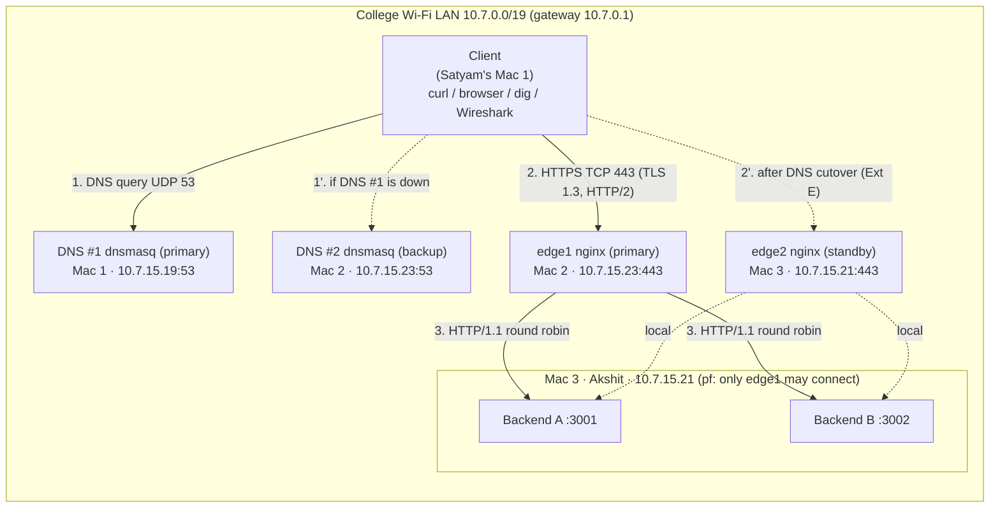
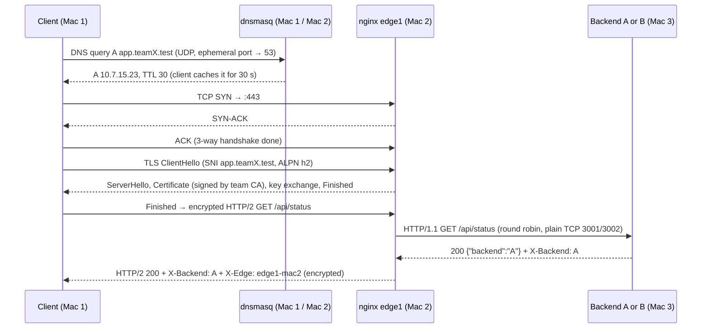

# Architecture & Network Design (Phase 1 + Phase 2)

> *The application stays simple — the network is the project.*

## Team and machine roles

| Mac | Member | Enrollment | Phase 1 role | Phase 2 additions |
| --- | --- | --- | --- | --- |
| **Mac 1** | Satyam Kumar (lead) | 2401010428 | Private DNS (`dnsmasq`), test client, Wireshark | **Primary** resolver, operator Mac (runs `deploy.sh` / `demo.sh`) |
| **Mac 2** | Krishna Verma | 2401010240 | Edge: nginx reverse proxy, TLS, load balancer, mkcert CA | **Backup DNS** resolver (Ext A), health detection + retry (Ext D) |
| **Mac 3** | Akshit Vats | 2401020085 | Backend A `:3001` + Backend B `:3002` (Flask) | **Standby edge** nginx (Ext E), **backend firewall** with pf (Ext C) |

The brief's "Mac 4 = Backend B" role is combined onto Mac 3 (allowed for a 3-person team: *"Teams of 2–3 may combine machine roles"*).

## Topology

## IP and service inventory (verified 24 Nov 2026)

| Node | IP | Port(s) | Service | Runs as |
| --- | --- | --- | --- | --- |
| Mac 1 Satyam | `10.7.15.19` | UDP/TCP 53 | dnsmasq — primary resolver | user (`~/cn-project`) |
| Mac 2 Krishna | `10.7.15.23` | UDP/TCP 53 | dnsmasq — backup resolver | user |
| Mac 2 Krishna | `10.7.15.23` | TCP 80 → 301, TCP 443 | nginx edge1 (TLS termination, HTTP/2, LB) | **root** (see below) |
| Mac 3 Akshit | `10.7.15.21` | TCP 3001 / 3002 | Flask backend A / B | user |
| Mac 3 Akshit | `10.7.15.21` | TCP 80 → 301, TCP 443 | nginx edge2 (standby, same config + cert) | user |
| Mac 3 Akshit | `10.7.15.21` | — | pf anchor `com.apple/cn-backend-isolation` | root (applied on demand) |

Addresses come from DHCP and change (e.g. every month). The **only** place they are written is
[`team/team.env`](../team/team.env); every config is rendered from it (`scripts/render-configs.sh`) and pushed by
`scripts/deploy.sh`. When IPs change: `scripts/update-ips.sh mac2=<ip> mac3=<ip> --deploy`.

### DNS records (identical on both resolvers)

| Name | Type | Value | TTL |
| --- | --- | --- | --- |
| `app.teamX.test` | A | `10.7.15.23` (edge1) — `10.7.15.21` after an Ext E cutover | 30 s |
| `api.teamX.test` | A | same as above | 30 s |
| anything else `*.teamX.test` | — | NXDOMAIN (`local=/teamX.test/`) | — |
| all other names | — | forwarded to `10.5.7.1`, `8.8.8.8` | upstream |

## Cloud equivalents

| Our component | Cloud equivalent |
| --- | --- |
| dnsmasq primary + backup, 30 s TTL | Route 53 hosted zone (multiple name servers, record TTL) |
| nginx edge (TLS termination, round robin, passive health checks) | AWS ALB / GCP HTTPS Load Balancer, CDN edge |
| DNS cutover edge1 → edge2 | Route 53 weighted / failover routing, blue-green deployment |
| pf rule "only the edge may reach :3001/:3002" | Security group allowing the backend port only from the LB's security group |
| Two Flask instances | Target group / instance group |

## Request flow — one client request, every layer

## Protocol layer map

| Layer (TCP/IP) | OSI | In our request |
| --- | --- | --- |
| Application | 7 (+6/5) | DNS query/response; HTTP/2 client↔edge, HTTP/1.1 edge↔backend; REST JSON; `Cache-Control`/`ETag`/304 |
| (security) | 5/6 | TLS 1.3 (1.2 in the capture) terminated at nginx; certificate for `app/api.teamX.test` from our mkcert CA |
| Transport | 4 | UDP 53 (DNS); TCP 443 (HTTPS), 80 (redirect), 3001/3002 (backends); ephemeral client ports |
| Internet | 3 | IPv4 10.7.0.0/19, all hosts on one subnet (no routing between them) |
| Link | 2 | Wi-Fi (802.11), ARP resolves the neighbour's MAC address |

## What changed in Phase 2

| Area | Phase 1 | Phase 2 |
| --- | --- | --- |
| Config management | hand-edited files per Mac, IPs hard-coded | one inventory (`team/team.env`) → rendered configs → `deploy.sh` over SSH |
| DNS | one dnsmasq (Mac 1), `host-record` lines, root via brew services | **two** resolvers with the same zone in a reloadable hosts file; `local-ttl=30`; clients list both |
| Edge | nginx with `max_fails=2`, plain HTTP on :80 | passive health checks `max_fails=1 fail_timeout=10s` + `proxy_next_upstream` retry; :80 → 301 HTTPS; `X-Edge` header; `/edge-health`; upstream-aware access log |
| Standby | — | edge2 on Mac 3 with the same config and certificate (DNS cutover) |
| Isolation | backends reachable by anyone on the Wi-Fi | pf on Mac 3: only edge1 may reach 3001/3002; rollback copy kept |
| Diagnosis | manual | `diagnose.sh` walks L1→L7 and names the first failing layer |
| Processes | `sudo brew services` | self-contained `~/cn-project` per Mac, controlled by `cn.sh` (no root) — except edge1, see below |

### Why edge1 runs as root (macOS Local Network privacy)

On macOS 15+ a **non-Apple** program may open connections to other hosts on the local subnet only while the
SSH session / Terminal that launched it is alive — or if it runs as **root**. Started over SSH as a normal user,
Krishna's nginx lost LAN access as soon as `deploy.sh` disconnected, and every upstream connect failed with
`connect() to 10.7.15.21:3001 failed (65: No route to host)` → 502. We reproduced it with `openssl s_client`
(works in the session, fails once the session has ended) and fixed it by running edge1 as root through a
root-owned helper (`scripts/phase2/edge-root.sh`). Phase 1 never saw it because nginx ran as root under
`sudo brew services`. The standby edge is unaffected: its upstreams are on its own IP.

## Remaining single points of failure

- **edge1 (nginx on Mac 2)** — the DNS record names a single edge. Ext E is a *manual* failover (takes one TTL).
  To remove it: two edges sharing a floating/virtual IP with VRRP (keepalived), or two A records + client retry,
  or a managed load balancer (ALB) with health-checked DNS failover (Route 53).
- **Mac 3 hosts both backends** — one laptop failure takes out A and B. Fix: put B on a fourth Mac.
- **Wi-Fi / the college access point** — every hop crosses one shared LAN.
- **The CA key on Mac 2** — if lost, certificates cannot be reissued (clients still trust existing ones).
